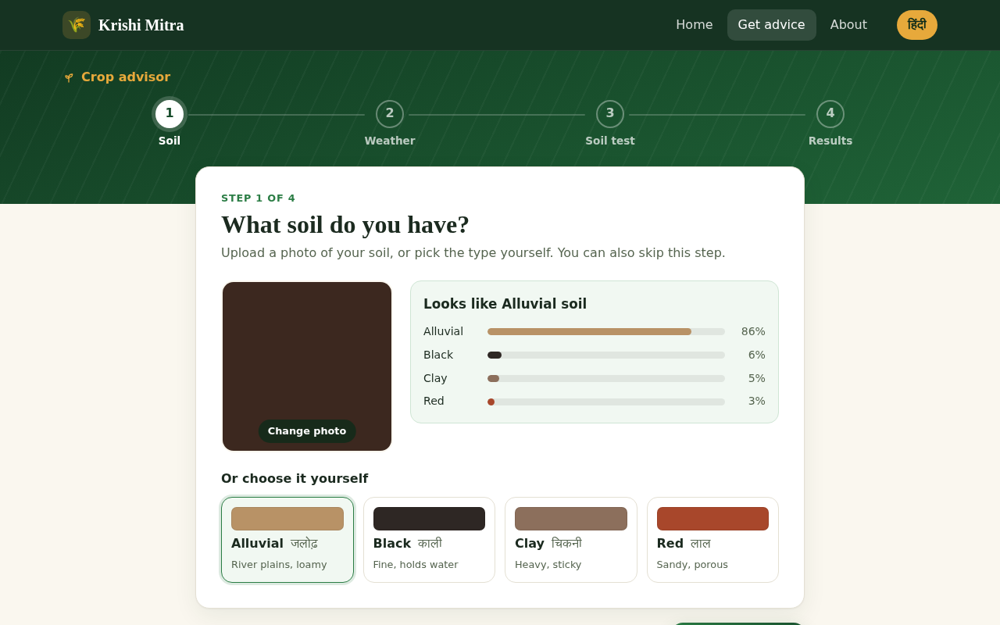
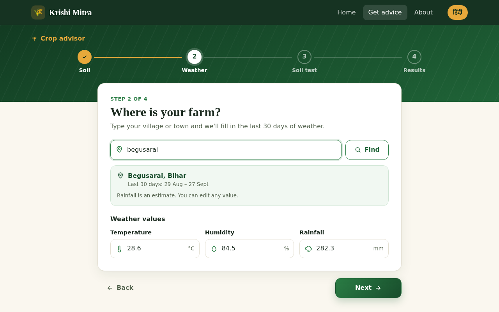
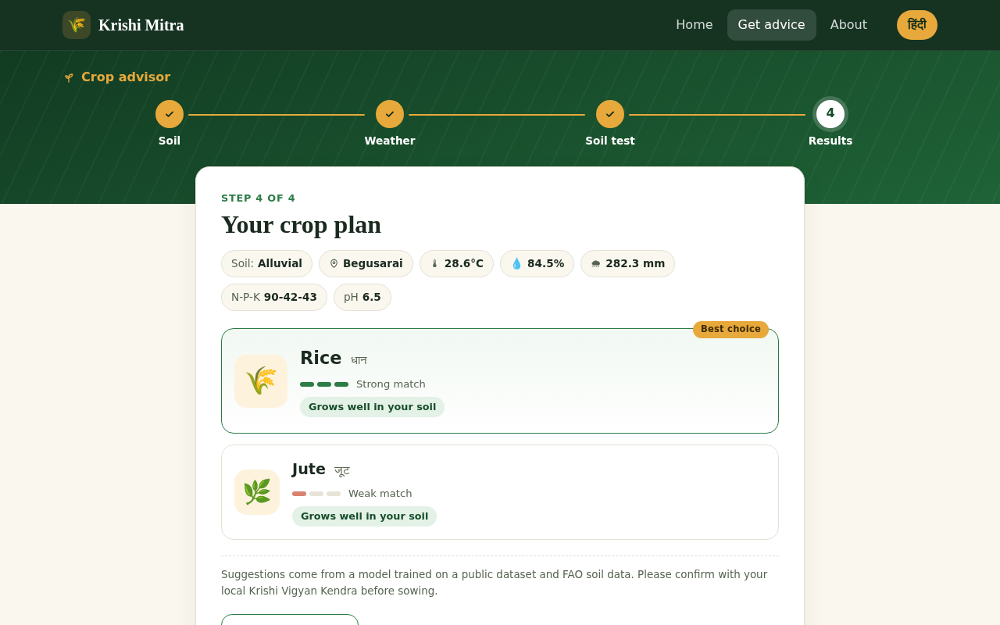
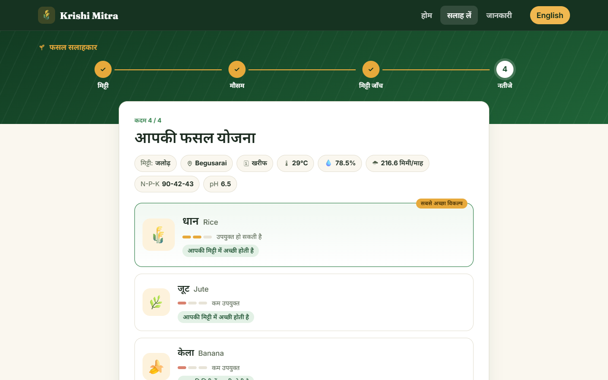
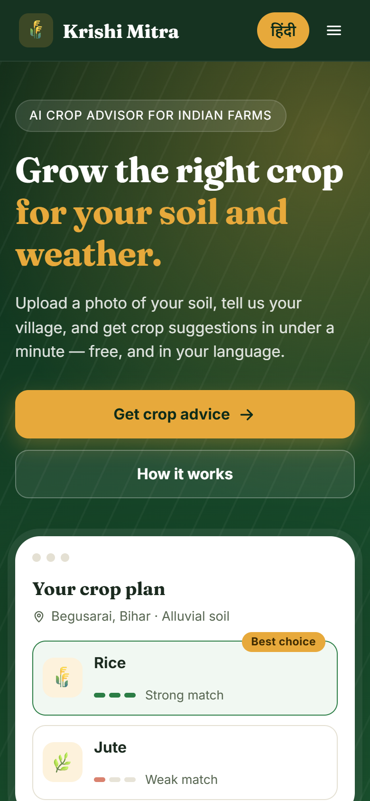
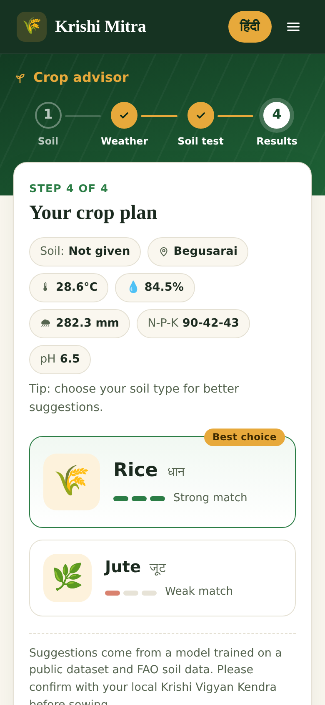
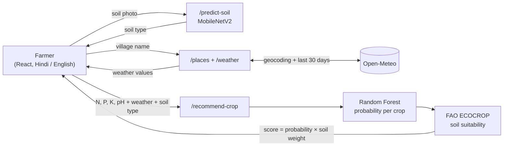
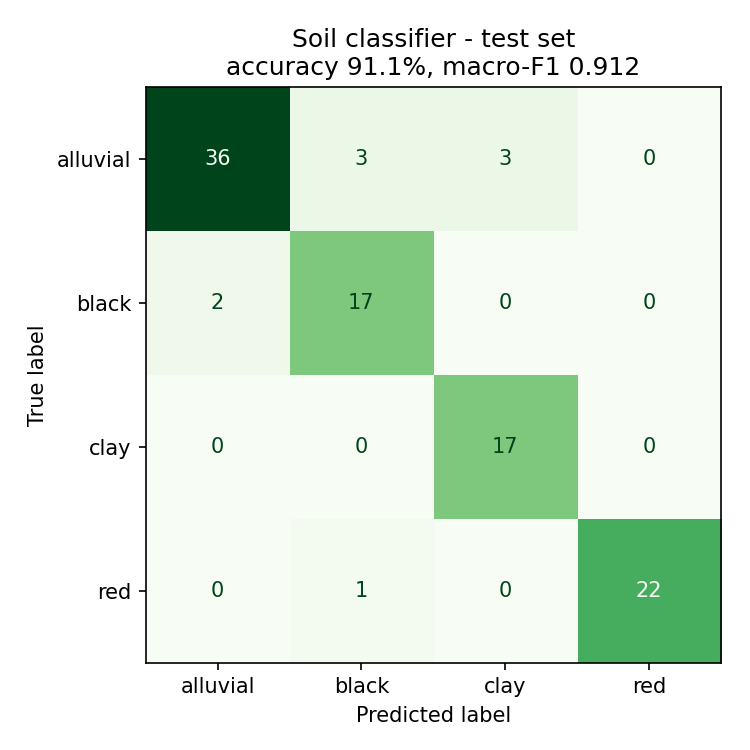
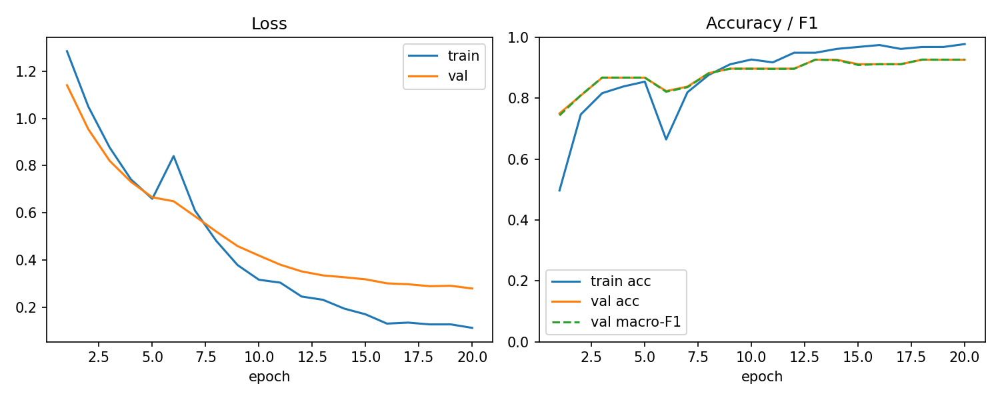
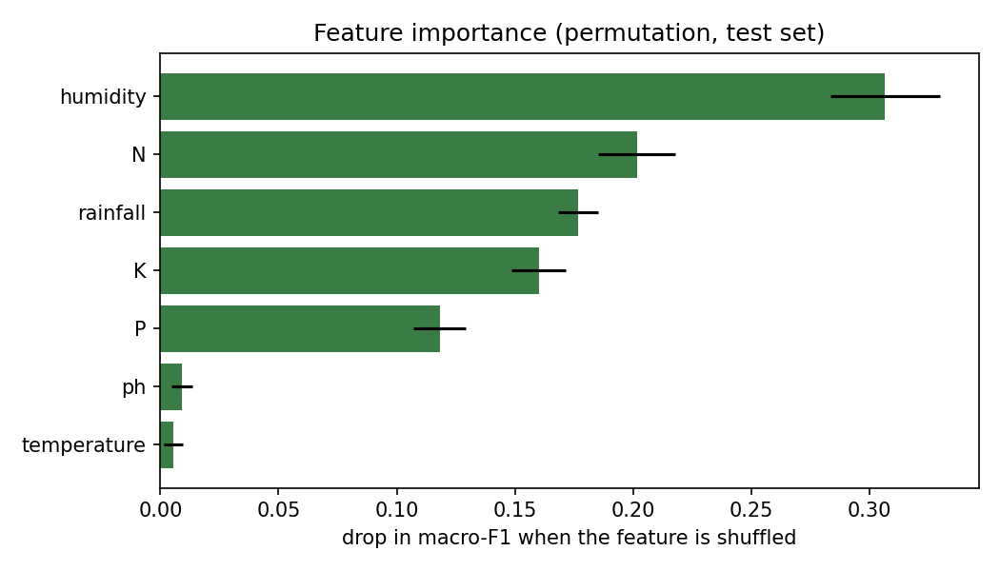

<div align="center">

# 🌾 Krishi Mitra — कृषि मित्र

**A farmer-first crop advisor: soil type from a photo, live local weather, and crop suggestions that respect your soil — in Hindi and English.**


[](https://github.com/Ayush-ji2024/krishi-mitra/actions/workflows/ci.yml)

<!-- Live demo: add the link here after deployment -->


</div>

---

## Contents

- [What it does](#what-it-does)
- [Screenshots](#screenshots)
- [Highlights](#highlights)
- [How it works](#how-it-works)
- [Data audit: what was wrong with the original data](#data-audit-what-was-wrong-with-the-original-data)
- [Models and results](#models-and-results)
- [Project structure](#project-structure)
- [Run it locally](#run-it-locally)
- [Deploy (live demo)](#deploy-live-demo)
- [API](#api)
- [Limitations and future work](#limitations-and-future-work)
- [Credits](#credits)

---

## What it does

A farmer answers three simple questions, one screen at a time:

1. **Your soil** — upload a photo and a CNN suggests the soil type (alluvial, black, clay or red), or simply pick it.
2. **Where is your farm?** — type a village or town; the last 30 days of temperature, humidity and rainfall are filled in automatically.
3. **Your soil test** — enter N, P, K and pH from the Soil Health Card.

Krishi Mitra then shows the best-fitting crops, how strongly each one matches, and whether it suits **that** soil type — in plain words, never as a misleading percentage.

## Screenshots

| Soil from a photo | Weather from a village name |
|---|---|
|  |  |

| Crop plan (English) | Crop plan (Hindi) |
|---|---|
|  |  |

<p align="center">
  
  &nbsp;&nbsp;
  
</p>

## Highlights

- 🔍 **Found and fixed a broken dataset.** 57% of the soil images were exact duplicates, and **every single test image (341/341) also appeared in the training set** — the original accuracy was memorisation. Rebuilt a leakage-free, stratified split.
- 🧠 **Soil classifier: 91.1% test accuracy, 0.91 macro-F1** with MobileNetV2 transfer learning (two-phase fine-tuning, class-weighted loss, augmentation), trained on a CPU in ~12 minutes.
- 🌱 **Crop recommender: 99.3% test accuracy, 100% top-3 accuracy**, chosen by benchmarking Logistic Regression, an MLP and Random Forest with 5-fold stratified cross-validation.
- 🧭 **Soil-aware ranking** using the FAO ECOCROP crop database, so a crop that does not suit the farmer's soil is moved down — without hiding what the model thinks.
- 🌦️ **Weather auto-fill** from Open-Meteo (no API key), with geocoding for Indian villages and towns.
- 🛡️ **Honest by design:** out-of-range inputs trigger warnings, low-confidence soil predictions are flagged, near-zero suggestions are hidden, and the UI never presents a ranking score as a probability.
- ✅ **21 automated tests** (API, ranking maths, mocked weather service); FastAPI validates every input.
- 📱 **Mobile-first React UI**: step-by-step wizard, sticky thumb-reachable actions, Hindi/English switch, no extra UI libraries.

## How it works



**Soil-aware re-ranking.** The Kaggle crop dataset has no soil column, so soil type is added with an external, citable source: the [FAO ECOCROP](https://gaez.fao.org/pages/ecocrop) database lists the soil textures each crop grows in. Each soil class is mapped to a texture (black and clay → heavy, alluvial → medium, red → light), and every crop gets a rating per soil — `good` (optimal texture), `possible` (tolerated) or `poor`. The final ranking is

```
score = model probability × soil weight      (good 1.0 · possible 0.7 · poor 0.4)
```

This is a *soft* re-ranking: if the model is very confident, a "possible" soil does not overturn it; soil decides between crops the model finds similar. The table is generated reproducibly by [`scripts/build_soil_suitability.py`](scripts/build_soil_suitability.py) and sanity-checks against known agronomy (cotton is "good" on black soil, coffee "poor" on heavy soils).

**Weather.** The API geocodes the place name and fetches daily data for the last 30 days: mean temperature, mean humidity and total rainfall. If exactly one place matches, it is picked automatically; if several do (e.g. *Rampur* exists in many states), the farmer chooses.

## Data audit: what was wrong with the original data

This project started as a team prototype at C-DAC Patna. Before retraining anything, the data and code were audited ([`scripts/prepare_soil_data.py`](scripts/prepare_soil_data.py)):

| Finding | Evidence | Fix |
|---|---|---|
| Exact duplicate images | **887 of 1,563** images (57%) were byte-identical copies, e.g. `images386.jpg` and `Copy of images386.jpg` | MD5-hash de-duplication → **672 unique images** |
| Train–test leakage | **341 of 341** original test images were also in the training set | New stratified **70 / 15 / 15** split (470 / 101 / 101), fixed seed |
| Conflicting labels | The same image was labelled both *alluvial* and *black* | All copies of conflicting images dropped |
| Class imbalance | Alluvial had ~2.5× more images than clay | Class-weighted loss + macro-F1 for model selection |
| Mixed / unreadable formats | A `.gif` silently skipped by PyTorch's `ImageFolder`, a stray `.DS_Store` | Every image re-saved as RGB JPEG; non-images skipped |
| Synthetic crop rows | 700 randomly generated rows for 7 extra crops | Removed — only the real dataset is used |

Bugs fixed in the original code: soil classes of the image model and crop model did not match (`clay` vs `laterite`); the app's model sizes (22 classes, 15 inputs) could not load the trained model (29 classes, 11 inputs); the "best" model checkpoint was a reference to the live weights, so the last epoch was saved instead of the best one (fixed with `copy.deepcopy`); the crop model used its test set for early stopping.

## Models and results

All numbers are on held-out test data that was used exactly once, after model selection on validation data.

### Soil classifier — MobileNetV2 (transfer learning)

Two phases: train only the new classification head (5 epochs), then fine-tune the last 4 backbone blocks at a 10× lower learning rate with early stopping on validation macro-F1.

| Soil | Precision | Recall | F1 | Test images |
|---|---|---|---|---|
| Alluvial | 0.947 | 0.857 | 0.900 | 42 |
| Black | 0.810 | 0.895 | 0.850 | 19 |
| Clay | 0.850 | 1.000 | 0.919 | 17 |
| Red | 1.000 | 0.957 | 0.978 | 23 |
| **Overall** | | | **accuracy 0.911 · macro-F1 0.912** | **101** |

Most errors are alluvial soil predicted as black or clay — alluvial soil varies from light brown to dark, overlapping with both. With only 101 test images, the accuracy has roughly ±6% uncertainty.

<p>
  
  
</p>

### Crop recommender — model comparison

| Model | 5-fold CV macro-F1 (train split) |
|---|---|
| Logistic Regression | 0.968 ± 0.007 |
| MLP (small neural network, as in the original project) | 0.980 ± 0.007 |
| **Random Forest** ✅ | **0.994 ± 0.006** |

The winning Random Forest scored **99.3% accuracy, 0.993 macro-F1 and 100% top-3 accuracy** on 440 unseen rows (22 crops). Its three mistakes were agronomically close pairs: rice → jute, lentil → moth beans, black gram → maize. Permutation importance ranks humidity, nitrogen, rainfall and potassium highest.

> The Kaggle dataset is known to be easy to separate — even Logistic Regression reaches ~97% — so these scores say more about the dataset than about real fields.

<p>
  
</p>

## Project structure

```
krishi-mitra/
├── backend/
│   ├── app/
│   │   ├── main.py               # FastAPI app: endpoints, CORS, model loading
│   │   ├── soil.py               # MobileNetV2 inference via ONNX Runtime (same preprocessing as training)
│   │   ├── crop.py               # Random Forest inference + soil re-ranking + range warnings
│   │   ├── weather.py            # Open-Meteo geocoding and 30-day weather
│   │   ├── schemas.py            # Pydantic request/response models and validation
│   │   └── soil_suitability.json # generated from FAO ECOCROP
│   └── tests/                    # 21 pytest tests (API, ranking, mocked weather)
├── frontend/                     # React + Vite, mobile-first, Hindi/English
│   └── src/
│       ├── pages/                # Home, Advisor (4-step wizard), About
│       ├── advisor/              # the wizard steps and their shared state
│       ├── i18n/                 # English and Hindi strings
│       └── styles/
├── scripts/
│   ├── prepare_soil_data.py      # audit, de-duplicate and split the soil images
│   ├── train_soil_classifier.py  # MobileNetV2 transfer learning + reports
│   ├── export_soil_onnx.py       # PyTorch → ONNX for the API (checked against PyTorch)
│   ├── train_crop_recommender.py # model comparison with CV + reports
│   └── build_soil_suitability.py # FAO ECOCROP → soil_suitability.json
├── reports/                      # metrics, confusion matrices, training curves
├── docs/screenshots/
├── models/                       # runtime models (ONNX + joblib, ~20 MB) for the API
├── render.yaml                   # Render deployment (free plan)
├── requirements.txt              # API runtime dependencies (pinned, no PyTorch)
├── requirements-train.txt        # + PyTorch, ONNX, matplotlib for training
└── requirements-dev.txt          # + pytest
```

## Run it locally

Requires **Python 3.10** and a recent **Node.js LTS (22 or newer)**.

### 1. Backend setup

```bash
python -m venv venv
venv\Scripts\activate            # Windows  (macOS/Linux: source venv/bin/activate)
pip install -r requirements-dev.txt           # enough to run the API and the tests
```

The trained runtime models are in `models/`, so the API runs straight away. To **retrain**, also install PyTorch (CPU build) and the training extras:

```bash
pip install torch torchvision --index-url https://download.pytorch.org/whl/cpu
pip install -r requirements-train.txt
```

### 2. Data

| Data | Where to put it |
|---|---|
| Soil images (4 classes: Alluvial, Black, Clay, Red — `Train/` and `test/` folders) | `data/soil_images/` |
| [Crop Recommendation dataset (Kaggle)](https://www.kaggle.com/datasets/atharvaingle/crop-recommendation-dataset) | `data/Crop_recommendation.csv` |
| FAO ECOCROP (only to rebuild the soil table) | `git clone --depth 1 https://github.com/OpenCLIM/ecocrop.git data/external/ecocrop` |

`data/` is git-ignored. In `models/` only the two runtime models are committed; the PyTorch checkpoint (`soil_classifier.pt`) stays local.

### 3. Train the models

```bash
python scripts/prepare_soil_data.py          # audit + clean split → data/soil_split/
python scripts/train_soil_classifier.py      # → models/soil_classifier.pt, reports/soil/
python scripts/export_soil_onnx.py           # → models/soil_classifier.onnx (what the API loads)
python scripts/train_crop_recommender.py     # → models/crop_recommender.joblib, reports/crop/
python scripts/build_soil_suitability.py     # optional: rebuild backend/app/soil_suitability.json
```

### 4. Run the API and the tests

```bash
uvicorn backend.app.main:app --reload        # http://127.0.0.1:8000/docs
python -m pytest backend/tests -v
```

On GitHub, [CI](.github/workflows/ci.yml) runs all tests (with the committed models), the frontend lint and the build on every push.

### 5. Run the website

```bash
cd frontend
npm install
npm run dev                                  # http://localhost:5173
```

The frontend reads the backend address from `VITE_API_URL` (see `frontend/.env.example`); the backend allows browser calls from the origins in `ALLOWED_ORIGINS` (default `http://localhost:5173`).

## Deploy (live demo)

The backend runs on **Render's free plan** and the website on **Vercel**, both deployed straight from this GitHub repo.

**Why ONNX:** importing PyTorch alone made the API use ~440 MB of RAM — too close to the free plan's 512 MB. The soil model is exported to ONNX ([`scripts/export_soil_onnx.py`](scripts/export_soil_onnx.py)) and run with ONNX Runtime: **~220 MB**, and the same prediction as PyTorch on all 101 test images. PyTorch is now only needed for training.

**1. Backend → Render**

In the [Render dashboard](https://dashboard.render.com): *New → Blueprint* → pick this repo. [`render.yaml`](render.yaml) sets everything up (Python 3.10, `pip install -r requirements.txt`, uvicorn, health check on `/health`). When asked for `ALLOWED_ORIGINS`, enter the Vercel URL from step 2 (or `http://localhost:5173` for now and change it later under *Environment*). The API is then live at `https://krishi-mitra-api.onrender.com` (or a similar name); check `/health`.

**2. Website → Vercel**

Import the repo at [vercel.com/new](https://vercel.com/new), set **Root Directory** to `frontend` (Vite is detected automatically) and add the environment variable `VITE_API_URL = <your Render URL>`. Hash routing (`/#/advisor`) means no rewrite rules are needed.

**3. Allow the website to call the API (CORS)**

On Render, set `ALLOWED_ORIGINS = https://<your-site>.vercel.app` (comma-separated for several). Optionally `ALLOWED_ORIGIN_REGEX` for Vercel preview URLs, e.g. `^https://krishi-mitra(-[a-z0-9-]+)?\.vercel\.app$`.

> The free Render plan sleeps after 15 minutes without visitors; the first request after that takes up to a minute while it wakes up.

A [`Dockerfile`](Dockerfile) is also included for any Docker host.

## API

Interactive docs are generated by FastAPI at `/docs`.

| Method | Endpoint | Purpose |
|---|---|---|
| `GET` | `/health` | Whether both models loaded |
| `GET` | `/meta` | Soil types, crops, training ranges and the soil suitability table |
| `POST` | `/predict-soil` | Image upload (≤ 5 MB) → soil type, confidence, per-class probabilities, `low_confidence` flag |
| `POST` | `/recommend-crop` | N, P, K, temperature, humidity, pH, rainfall, optional soil type → up to 3 crops with probability, soil suitability and warnings |
| `GET` | `/places?q=` | Indian places matching a name (Open-Meteo geocoding) |
| `GET` | `/weather?lat=&lon=` | Mean temperature, mean humidity and total rainfall over the last 30 days |

Example:

```bash
curl -X POST http://127.0.0.1:8000/recommend-crop \
  -H "Content-Type: application/json" \
  -d '{"N": 90, "P": 42, "K": 43, "temperature": 20.9, "humidity": 82, "ph": 6.5, "rainfall": 202.9, "soil_type": "alluvial"}'
```

Impossible values (e.g. pH 20) are rejected with `422`; values outside the training range are accepted with a warning; a failing weather service returns `502`.

## Limitations and future work

- **22 crops only.** Wheat, sugarcane, mustard and potato — major crops in Bihar — are not in the dataset. Adding them needs real data, not synthetic rows.
- **4 soil types, internet photos.** The soil model has not been tested on photos taken in real fields; accuracy there is likely lower.
- **Rainfall period is undocumented** in the crop dataset (its values of 20–300 mm are far below annual totals), so the 30-day total is an informed estimate that the farmer can edit.
- **Soil suitability uses texture only** — not drainage, salinity or local varieties — and its weights (1.0 / 0.7 / 0.4) are chosen, not learned.
- **Soil test values need a Soil Health Card.** Future work: estimate N-P-K ranges from district-level soil data when no card is available.

## Credits

- Original prototype built during an AI & Data Science internship at **C-DAC Patna** by Harshit Kashyap, Ayush Kumar, Pallavi Bharti and Sonu Kumar.
- Data audit, retraining, backend, soil-aware ranking, weather integration and web app by **Ayush Kumar** — [GitHub](https://github.com/Ayush-ji2024) · [LinkedIn](https://www.linkedin.com/in/ayush-kumar-793733309).
- Weather data by [Open-Meteo.com](https://open-meteo.com/) (CC BY 4.0) · Crop–soil data from [FAO ECOCROP](https://gaez.fao.org/pages/ecocrop), via [OpenCLIM/ecocrop](https://github.com/OpenCLIM/ecocrop) · Crop dataset: [Crop Recommendation Dataset](https://www.kaggle.com/datasets/atharvaingle/crop-recommendation-dataset) on Kaggle.
