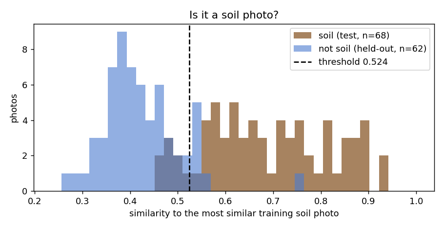

<div align="center">

# 🌾 Krishi Mitra — कृषि मित्र

**A farmer-first crop advisor: soil type from a photo, the usual weather of your village for the season you will grow in, and crop suggestions that respect your soil — in Hindi and English.**


[](https://github.com/Ayush-ji2024/krishi-mitra/actions/workflows/ci.yml)

### [🌐 Live demo → krishi-mitra-silk-one.vercel.app](https://krishi-mitra-silk-one.vercel.app)

<sub>Backend on Render's free plan: the first request after a quiet spell can take up to a minute while the server wakes up.</sub>


</div>

---

## Contents

- [What it does](#what-it-does)
- [Screenshots](#screenshots)
- [Highlights](#highlights)
- [How it works](#how-it-works)
- [Data audit: what was wrong with the original data](#data-audit-what-was-wrong-with-the-original-data)
- [Models and results](#models-and-results)
- [Project structure](#project-structure)
- [Run it locally](#run-it-locally)
- [Deploy (live demo)](#deploy-live-demo)
- [API](#api)
- [Limitations and future work](#limitations-and-future-work)
- [Credits](#credits)

---

## What it does

A farmer answers three simple questions, one screen at a time:

1. **Your soil** — upload a photo and a CNN suggests the soil type (alluvial, black, clay or red), or simply pick it.
2. **Where is your farm?** — type a village or town and pick the season (Kharif, Rabi or Zaid); the usual temperature, humidity and rainfall of that season — a 5-year average for that place — are filled in automatically.
3. **Your soil test** — enter N, P, K and pH from the Soil Health Card.

Krishi Mitra then shows the best-fitting crops, how strongly each one matches, and whether it suits **that** soil type — in plain words, never as a misleading percentage.

## Screenshots

| Soil from a photo | Weather from a village name |
|---|---|
|  |  |

| Crop plan (English) | Crop plan (Hindi) |
|---|---|
|  |  |

<p align="center">
  
  &nbsp;&nbsp;
  
</p>

## Highlights

- 🔍 **Found and fixed a broken dataset.** 57% of the soil images were exact duplicates and **every single test image (341/341) also appeared in the training set** — the original accuracy was memorisation. A second audit with perceptual hashing found **204 near-duplicates** (resized, watermarked or mirrored copies, burst shots) that still leaked into the test set. Rebuilt a leakage-free, stratified split of 452 truly distinct photos.
- 🧠 **Soil classifier: 82.4% test accuracy, 0.81 macro-F1** on photos with no copy in training, with MobileNetV2 transfer learning (two-phase fine-tuning, class-weighted loss, augmentation), trained on a CPU in ~12 minutes. (The earlier 91% was inflated by near-duplicates: 100% on leaked test photos, 87% on the rest.)
- 🌱 **Crop recommender: 99.3% test accuracy, 100% top-3 accuracy**, chosen by benchmarking Logistic Regression, an MLP and Random Forest with 5-fold stratified cross-validation.
- 🧭 **Soil-aware ranking** using the FAO ECOCROP crop database, so a crop that does not suit the farmer's soil is moved down — without hiding what the model thinks.
- 🌦️ **Weather auto-fill** from Open-Meteo (no API key), with geocoding for Indian villages and towns.
- 📅 **Season-aware weather:** a crop is chosen for the season it will grow in, so the form is filled with that season's 5-year normals for the village — not with last month's weather.
- 🚫 **Knows when a photo is not soil:** a selfie, a screenshot or a blank picture is recognised (87% of held-out non-soil photos caught, 90% of soil photos accepted) instead of being forced into a soil type.
- 🛡️ **Honest by design:** out-of-range inputs trigger warnings, low-confidence soil predictions are flagged, near-zero suggestions are hidden, and the UI never presents a ranking score as a probability.
- ✅ **32 automated tests** (API, not-soil check, ranking maths, mocked seasonal weather) run on every push by CI; FastAPI validates every input.
- 📱 **Mobile-first React UI**: step-by-step wizard, sticky thumb-reachable actions, Hindi/English switch, no extra UI libraries.

## How it works


**Soil-aware re-ranking.** The Kaggle crop dataset has no soil column, so soil type is added with an external, citable source: the [FAO ECOCROP](https://gaez.fao.org/pages/ecocrop) database lists the soil textures each crop grows in. Each soil class is mapped to a texture (black and clay → heavy, alluvial → medium, red → light), and every crop gets a rating per soil — `good` (optimal texture), `possible` (tolerated) or `poor`. The final ranking is

```
score = model probability × soil weight      (good 1.0 · possible 0.7 · poor 0.4)
```

This is a *soft* re-ranking: if the model is very confident, a "possible" soil does not overturn it; soil decides between crops the model finds similar. The table is generated reproducibly by [`scripts/build_soil_suitability.py`](scripts/build_soil_suitability.py) and sanity-checks against known agronomy (cotton is "good" on black soil, coffee "poor" on heavy soils).

**Weather by season.** A crop is chosen for the season it will *grow* in — asking in November should describe the Rabi winter, not October's monsoon tail. The API geocodes the place name, downloads the last 5 complete years of daily weather from the Open-Meteo historical archive (ERA5) in one request, and computes each season's normals: **Kharif** (Jun–Oct), **Rabi** (Nov–Mar) and **Zaid** (Mar–Jun) — mean temperature, mean humidity and the **average rainfall per month**. The crop dataset's rainfall (20–300 mm) matches monthly totals, not seasonal or yearly ones, so a per-month figure fits the model best. The upcoming season is pre-selected from today's date, results are cached per location, and the farmer can switch season or edit any value. If exactly one place matches the name, it is picked automatically; if several do (e.g. *Rampur* exists in many states), the farmer chooses.

| Place | Kharif (Jun–Oct) | Rabi (Nov–Mar) | Zaid (Mar–Jun) |
|---|---|---|---|
| Begusarai, Bihar | 29.0 °C · 79 % · 217 mm/month | 19.6 °C · 72 % · 11 mm/month | 29.1 °C · 57 % · 67 mm/month |
| Jaipur, Rajasthan | 28.3 °C · 67 % · 124 mm/month | 18.9 °C · 54 % · 10 mm/month | 30.0 °C · 35 % · 30 mm/month |
| Kochi, Kerala | 26.1 °C · 89 % · 385 mm/month | 27.1 °C · 79 % · 91 mm/month | 27.5 °C · 84 % · 340 mm/month |

<sub>Normals for 2021–2025 as returned by the API.</sub>

## Data audit: what was wrong with the original data

This project started as a team prototype at C-DAC Patna. Before retraining anything, the data and code were audited ([`scripts/prepare_soil_data.py`](scripts/prepare_soil_data.py)):

| Finding | Evidence | Fix |
|---|---|---|
| Exact duplicate images | **887 of 1,563** images (57%) were byte-identical copies, e.g. `images386.jpg` and `Copy of images386.jpg` | MD5-hash de-duplication → 672 files |
| Train–test leakage | **341 of 341** original test images were also in the training set | New stratified **70 / 15 / 15** split, fixed seed |
| Near-duplicate images | After MD5 de-duplication, **204** more photos were copies of another one: resized, re-compressed, watermarked or mirrored versions and burst shots of the same field. **34 of 101 test photos** had such a copy in train — the model scored **100%** on them and **86.6%** on the rest | Perceptual-hash (pHash) grouping, one photo per group → **452 distinct photos**, split 316 / 68 / 68 with no near-copy across train and test |
| Conflicting labels | The same image labelled *alluvial* and *black*; 8 more stock photos labelled both *alluvial* and *clay* (found as near-duplicates) | All copies of conflicting images dropped |
| Class imbalance | Alluvial seemed ~2.5× bigger than clay — mostly because of its copies (114 vs 96 after de-duplication) | Class-weighted loss + macro-F1 for model selection |
| Mixed / unreadable formats | A `.gif` silently skipped by PyTorch's `ImageFolder`, a stray `.DS_Store` | Every image re-saved as RGB JPEG; non-images skipped |
| Synthetic crop rows | 700 randomly generated rows for 7 extra crops | Removed — only the real dataset is used |

**How near-duplicates are found.** Every photo gets a 63-bit perceptual hash (grayscale 32×32 → DCT → low frequencies above the median), also for its mirror image. Two photos are grouped if their hashes differ in ≤ 6 bits, or in ≤ 10 bits *and* their average colour matches (≤ 1.5 of 255) — the colour rule stops different soil heaps on the same black background from being merged (among 400 such pairs it merged 326 same-label pairs and no different-label pair). Thresholds were chosen by looking at image pairs at each distance. One possible near-copy remains between train and validation (it can affect model selection, not the test score).

Bugs fixed in the original code: soil classes of the image model and crop model did not match (`clay` vs `laterite`); the app's model sizes (22 classes, 15 inputs) could not load the trained model (29 classes, 11 inputs); the "best" model checkpoint was a reference to the live weights, so the last epoch was saved instead of the best one (fixed with `copy.deepcopy`); the crop model used its test set for early stopping.

## Models and results

All numbers are on held-out test data that was used exactly once, after model selection on validation data.

### Soil classifier — MobileNetV2 (transfer learning)

Two phases: train only the new classification head (5 epochs), then fine-tune the last 4 backbone blocks at a 10× lower learning rate with early stopping on validation macro-F1.

| Soil | Precision | Recall | F1 | Test images |
|---|---|---|---|---|
| Alluvial | 0.750 | 0.882 | 0.811 | 17 |
| Black | 0.842 | 0.889 | 0.865 | 18 |
| Clay | 0.750 | 0.643 | 0.692 | 14 |
| Red | 0.941 | 0.842 | 0.889 | 19 |
| **Overall** | | | **accuracy 0.824 · macro-F1 0.814** | **68** |

Clay is the hardest class: 3 of 14 clay photos are predicted as alluvial — dry clay and alluvial soil look alike in a photo. With only 68 test images the accuracy is uncertain: the 95% confidence interval is **72–90%**. This is lower than the earlier 91%, and more honest: none of these test photos has a copy in the training set.

<p>
  
  
</p>

### "Is this even soil?" — rejecting non-soil photos

A classifier always answers with one of its classes, so a selfie would be called "alluvial". To catch this, every photo's 1280-number feature fingerprint (the layer before the classifier) is compared with the fingerprints of the 316 training soil photos; if even the **most similar training photo** has a cosine similarity below a threshold, the app says *"This doesn't look like a soil photo"* and does not pre-select a soil type ([deep k-NN](https://arxiv.org/abs/2204.06507), k = 1, in [`scripts/calibrate_soil_ood.py`](scripts/calibrate_soil_ood.py)).

- The **threshold** is set on the *validation* soil photos only: 95% of them pass. Rejecting a real soil photo only means the farmer picks the soil type by hand; calling a selfie "alluvial" would give wrong advice.
- Non-soil photos for evaluation: 100 random photos from picsum.photos (people, buildings, landscapes, objects), plain colours / noise / gradients, and the app's own screenshots — de-duplicated and split in half by the hash of each file. The **method and threshold were chosen on one half** together with the validation soil photos (k-NN k = 1 vs k = 5 vs Mahalanobis distance; 98% vs 95% pass rate) and **all numbers below use only the test soil photos and the other half**.

| | Result |
|---|---|
| Soil photos accepted (test set) | **90%** (61 / 68) |
| Non-soil photos caught (held-out, 62 photos) | **87%** — random photos 86%, generated 88%, screenshots 100% |
| AUROC, fingerprint similarity | **0.968** |
| AUROC, the classifier's own confidence (naive baseline) | 0.902 |

Before the near-duplicate fix this check looked better (96% / 93%) — test soil photos were then matched by their own copies in training. The check needs only the stored fingerprints (0.5 MB) and adds no noticeable time per photo.

<p></p>

### Crop recommender — model comparison

| Model | 5-fold CV macro-F1 (train split) |
|---|---|
| Logistic Regression | 0.968 ± 0.007 |
| MLP (small neural network, as in the original project) | 0.980 ± 0.007 |
| **Random Forest** ✅ | **0.994 ± 0.006** |

The winning Random Forest scored **99.3% accuracy, 0.993 macro-F1 and 100% top-3 accuracy** on 440 unseen rows (22 crops). Its three mistakes were agronomically close pairs: rice → jute, lentil → moth beans, black gram → maize. Permutation importance ranks humidity, nitrogen, rainfall and potassium highest.

> The Kaggle dataset is known to be easy to separate — even Logistic Regression reaches ~97% — so these scores say more about the dataset than about real fields.

<p>
  
</p>

## Project structure

```
krishi-mitra/
├── backend/
│   ├── app/
│   │   ├── main.py               # FastAPI app: endpoints, CORS, model loading
│   │   ├── soil.py               # MobileNetV2 inference via ONNX Runtime (same preprocessing as training)
│   │   ├── crop.py               # Random Forest inference + soil re-ranking + range warnings
│   │   ├── weather.py            # Open-Meteo geocoding + 5-year season normals (cached)
│   │   ├── schemas.py            # Pydantic request/response models and validation
│   │   └── soil_suitability.json # generated from FAO ECOCROP
│   └── tests/                    # 32 pytest tests (API, not-soil check, ranking, mocked weather)
├── frontend/                     # React + Vite, mobile-first, Hindi/English
│   └── src/
│       ├── pages/                # Home, Advisor (4-step wizard), About
│       ├── advisor/              # the wizard steps and their shared state
│       ├── i18n/                 # English and Hindi strings
│       └── styles/
├── scripts/
│   ├── prepare_soil_data.py      # audit, de-duplicate and split the soil images
│   ├── train_soil_classifier.py  # MobileNetV2 transfer learning + reports
│   ├── export_soil_onnx.py       # PyTorch → ONNX for the API (checked against PyTorch)
│   ├── calibrate_soil_ood.py     # "is this soil?" fingerprints + threshold + evaluation
│   ├── train_crop_recommender.py # model comparison with CV + reports
│   └── build_soil_suitability.py # FAO ECOCROP → soil_suitability.json
├── reports/                      # metrics, confusion matrices, training curves
├── docs/screenshots/
├── models/                       # runtime models (ONNX, joblib, soil fingerprints; ~21 MB)
├── render.yaml                   # Render deployment (free plan)
├── ruff.toml                     # Python lint rules (checked in CI)
├── requirements.txt              # API runtime dependencies (pinned, no PyTorch)
├── requirements-train.txt        # + PyTorch, ONNX, matplotlib for training
└── requirements-dev.txt          # + pytest
```

## Run it locally

Requires **Python 3.10** and a recent **Node.js LTS (22 or newer)**.

### 1. Backend setup

```bash
python -m venv venv
venv\Scripts\activate            # Windows  (macOS/Linux: source venv/bin/activate)
pip install -r requirements-dev.txt           # enough to run the API and the tests
```

The trained runtime models are in `models/`, so the API runs straight away. To **retrain**, also install PyTorch (CPU build) and the training extras:

```bash
pip install torch torchvision --index-url https://download.pytorch.org/whl/cpu
pip install -r requirements-train.txt
```

### 2. Data

| Data | Where to put it |
|---|---|
| Soil images (4 classes: Alluvial, Black, Clay, Red — `Train/` and `test/` folders) | `data/soil_images/` |
| [Crop Recommendation dataset (Kaggle)](https://www.kaggle.com/datasets/atharvaingle/crop-recommendation-dataset) | `data/Crop_recommendation.csv` |
| Non-soil photos (only to evaluate the not-soil check; any images) | `data/ood/` |
| FAO ECOCROP (only to rebuild the soil table) | `git clone --depth 1 https://github.com/OpenCLIM/ecocrop.git data/external/ecocrop` |

`data/` is git-ignored. In `models/` only the runtime files are committed (`crop_recommender.joblib`, `soil_classifier.onnx`, `soil_reference.npz`); the PyTorch checkpoint (`soil_classifier.pt`) stays local.

### 3. Train the models

```bash
python scripts/prepare_soil_data.py          # audit + clean split → data/soil_split/
python scripts/train_soil_classifier.py      # → models/soil_classifier.pt, reports/soil/
python scripts/export_soil_onnx.py           # → models/soil_classifier.onnx (what the API loads)
python scripts/calibrate_soil_ood.py         # → models/soil_reference.npz ("is this soil?" check)
python scripts/train_crop_recommender.py     # → models/crop_recommender.joblib, reports/crop/
python scripts/build_soil_suitability.py     # optional: rebuild backend/app/soil_suitability.json
```

### 4. Run the API and the tests

```bash
uvicorn backend.app.main:app --reload        # http://127.0.0.1:8000/docs
python -m pytest backend/tests -v
ruff check .                                 # Python lint (config in ruff.toml)
```

On GitHub, [CI](.github/workflows/ci.yml) runs the Python lint, all tests (with the committed models), the frontend lint and the build on every push.

### 5. Run the website

```bash
cd frontend
npm install
npm run dev                                  # http://localhost:5173
```

The frontend reads the backend address from `VITE_API_URL` (see `frontend/.env.example`); the backend allows browser calls from the origins in `ALLOWED_ORIGINS` (default `http://localhost:5173`).

## Deploy (live demo)

The backend runs on **Render's free plan** and the website on **Vercel**, both deployed straight from this GitHub repo.

**Why ONNX:** importing PyTorch alone made the API use ~440 MB of RAM — too close to the free plan's 512 MB. The soil model is exported to ONNX ([`scripts/export_soil_onnx.py`](scripts/export_soil_onnx.py)) and run with ONNX Runtime: **~220 MB**, and the same prediction as PyTorch on all 68 test images. PyTorch is now only needed for training.

**1. Backend → Render**

In the [Render dashboard](https://dashboard.render.com): *New → Blueprint* → pick this repo. [`render.yaml`](render.yaml) sets everything up (Python 3.10, `pip install -r requirements.txt`, uvicorn, health check on `/health`). When asked for `ALLOWED_ORIGINS`, enter the Vercel URL from step 2 (or `http://localhost:5173` for now and change it later under *Environment*). The API is then live at `https://krishi-mitra-api.onrender.com` (or a similar name); check `/health`.

**2. Website → Vercel**

Import the repo at [vercel.com/new](https://vercel.com/new), set **Root Directory** to `frontend` (Vite is detected automatically) and add the environment variable `VITE_API_URL = <your Render URL>`. Hash routing (`/#/advisor`) means no rewrite rules are needed.

**3. Allow the website to call the API (CORS)**

On Render, set `ALLOWED_ORIGINS = https://<your-site>.vercel.app` (comma-separated for several). Optionally `ALLOWED_ORIGIN_REGEX` for Vercel preview URLs, e.g. `^https://krishi-mitra(-[a-z0-9-]+)?\.vercel\.app$`.

> The free Render plan sleeps after 15 minutes without visitors; the first request after that takes up to a minute while it wakes up.

A [`Dockerfile`](Dockerfile) is also included for any Docker host.

## API

Interactive docs are generated by FastAPI at `/docs`.

| Method | Endpoint | Purpose |
|---|---|---|
| `GET` | `/health` | Whether both models loaded |
| `GET` | `/meta` | Soil types, crops, training ranges and the soil suitability table |
| `POST` | `/predict-soil` | Image upload (≤ 5 MB) → soil type, confidence, per-class probabilities, `low_confidence` and `is_soil` flags |
| `POST` | `/recommend-crop` | N, P, K, temperature, humidity, pH, rainfall, optional soil type → up to 3 crops with probability, soil suitability and warnings |
| `GET` | `/places?q=` | Indian places matching a name (Open-Meteo geocoding) |
| `GET` | `/weather?lat=&lon=` | For Kharif, Rabi and Zaid: mean temperature, mean humidity and average monthly rainfall over the last 5 years, plus the upcoming season |

Example:

```bash
curl -X POST http://127.0.0.1:8000/recommend-crop \
  -H "Content-Type: application/json" \
  -d '{"N": 90, "P": 42, "K": 43, "temperature": 20.9, "humidity": 82, "ph": 6.5, "rainfall": 202.9, "soil_type": "alluvial"}'
```

Impossible values (e.g. pH 20) are rejected with `422`; values outside the training range are accepted with a warning; a failing weather service returns `502`.

## Limitations and future work

- **22 crops only.** Wheat, sugarcane, mustard and potato — major crops in Bihar — are not in the dataset. Adding them needs real data, not synthetic rows.
- **4 soil types, internet photos.** The soil model has not been tested on photos taken in real fields; accuracy there is likely lower.
- **Small soil dataset.** After removing exact and near-duplicates only 452 distinct photos remain (68 for testing), so the 82% accuracy has a wide confidence interval (72–90%). More, and more varied, field photos are the most useful next step.
- **Not-soil check is a safety net, not a guarantee.** It was evaluated on 62 held-out non-soil photos; unusual pictures (e.g. sand, rock, a brown wall) can still pass.
- **Rainfall period is undocumented** in the crop dataset (its values of 20–300 mm are far below annual totals), so the season's average monthly rainfall is an informed choice that the farmer can edit. The crop model itself has no season input: in a dry Rabi season, rainfall may fall below the training range (the app then warns).
- **Soil suitability uses texture only** — not drainage, salinity or local varieties — and its weights (1.0 / 0.7 / 0.4) are chosen, not learned.
- **Soil test values need a Soil Health Card.** Future work: estimate N-P-K ranges from district-level soil data when no card is available.

## Credits

- Original prototype built during an AI & Data Science internship at **C-DAC Patna** by Harshit Kashyap, Ayush Kumar, Pallavi Bharti and Sonu Kumar.
- Data audit, retraining, backend, soil-aware ranking, weather integration and web app by **Ayush Kumar** — [GitHub](https://github.com/Ayush-ji2024) · [LinkedIn](https://www.linkedin.com/in/ayush-kumar-793733309).
- Weather data by [Open-Meteo.com](https://open-meteo.com/) (CC BY 4.0) · Crop–soil data from [FAO ECOCROP](https://gaez.fao.org/pages/ecocrop), via [OpenCLIM/ecocrop](https://github.com/OpenCLIM/ecocrop) · Crop dataset: [Crop Recommendation Dataset](https://www.kaggle.com/datasets/atharvaingle/crop-recommendation-dataset) on Kaggle.
